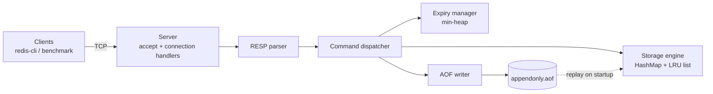

# mini-redis-java
# Mini Redis (Java)

A Redis-compatible, in-memory key-value store written in Java from scratch. It speaks the RESP protocol over TCP, so the standard `redis-cli` and `redis-benchmark` tools work against it. The project focuses on the data structures, concurrency and persistence behind a key-value server.

> **Status:** 🚧 Planned / in progress. Every feature below is unchecked until it is implemented and tested. Update this file as you go and delete anything you do not build.

## Features

- **Key-value commands** over TCP using the RESP protocol
- **Expiry (TTL)** using a min-heap, with lazy and active expiration
- **LRU eviction** with a hash map plus a doubly linked list (O(1) get and put)
- **Persistence** with an append-only file (AOF) and crash recovery by replaying the log
- **Concurrent clients** with a clearly documented concurrency model
- **Unit, concurrency and recovery tests**, plus a reproducible benchmark

## Supported commands

| Command | Description | Status |
|---|---|---|
| `PING` | health check | ☐ |
| `SET key value` | store a string value | ☐ |
| `GET key` | read a value | ☐ |
| `DEL key [key ...]` | delete keys | ☐ |
| `EXISTS key` | check whether a key exists | ☐ |
| `EXPIRE key seconds` | set a time to live | ☐ |
| `TTL key` | remaining time to live | ☐ |
| `INCR key` | atomic integer increment | ☐ |
| `KEYS pattern` | list matching keys | ☐ (optional) |

## Architecture



### Suggested package layout

```
src/main/java/com/yourname/miniredis/
  server/        # TCP server, connection handling
  protocol/      # RESP parser and encoder
  command/       # command interface and handlers
  store/         # storage engine, LRU cache
  expiry/        # TTL manager (min-heap)
  persistence/   # AOF writer and loader
  Main.java
src/test/java/...
```

## Design decisions

> Fill in the choices you actually make, and why.

| Concern | Choice | Complexity / notes |
|---|---|---|
| Key lookup | hash map | O(1) average |
| Expiry | min-heap keyed by expiry time (plus lazy deletion on read) | O(log n) insert, O(log n) removal |
| Eviction | LRU: hash map + doubly linked list | O(1) get and put |
| Persistence | append-only file, replay on startup | fsync policy: _always / every second / never_ |
| Concurrency | _thread pool / virtual threads / NIO selector_ | locking strategy: _describe_ |

Trade-offs to discuss here: why you chose this concurrency model, what happens when two clients `INCR` the same key at once, and how the AOF behaves if the process crashes mid-write.

## Getting started

### Prerequisites
- JDK 21 (or the version in `pom.xml`)
- Maven 3.9+

### Build and run

```bash
mvn clean package
java -jar target/mini-redis.jar --port 6379
```

### Try it

```bash
redis-cli -p 6379
127.0.0.1:6379> SET name sukh
OK
127.0.0.1:6379> GET name
"sukh"
127.0.0.1:6379> EXPIRE name 10
(integer) 1
```

`redis-cli` works because the server speaks RESP. You can also test without it using `nc localhost 6379`.

## Testing

```bash
mvn test
```

Planned test coverage:
- RESP parser: valid input, partial reads and malformed input
- LRU cache: eviction order and capacity limits
- Expiry: keys expire on time, and `TTL` values are correct
- Concurrency: many clients running `INCR` on one key produce the correct total
- Recovery: write data, kill the process, restart, and verify the data is restored


